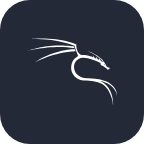
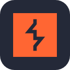
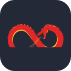
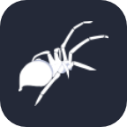

  

<b>cyber security · UAV · ai jailbreaks</b>

 

Cyber security student with a habit of testing limits. I find out how things break: networks, applications, language models, and the AI guardrails around them, to see what's actually behind them. Lately that curiosity has turned to UAVs, because the attack surface is still being written.

 

<code>pentesting</code> <code>ctf</code> <code>ai&nbsp;jailbreaks</code> <code>uav&nbsp;security</code> <code>adversarial&nbsp;ml</code> <code>osint</code> <code>reverse&nbsp;engineering</code> <code>full&nbsp;stack</code> <code>linux&nbsp;admin</code> <code>devops</code>

 

## stack

<table>
  <tr>
    <td align="right">languages</td>
    <td></td>
  </tr>
  <tr>
    <td align="right">security</td>
    <td>
            
    </td>
  </tr>
  <tr>
    <td align="right">uav</td>
    <td>
           
    </td>
  </tr>
  <tr>
    <td align="right">ai</td>
    <td>
       
    </td>
  </tr>
  <tr>
    <td align="right">infra &amp; dev</td>
    <td></td>
  </tr>
</table>

 

## stats

  
  

  

  <picture>
    <source media="(prefers-color-scheme: dark)" srcset="https://raw.githubusercontent.com/Manuja-15/Manuja-15/output/github-snake-dark.svg" />
    <source media="(prefers-color-scheme: light)" srcset="https://raw.githubusercontent.com/Manuja-15/Manuja-15/output/github-snake.svg" />
    
  </picture>

 

  

